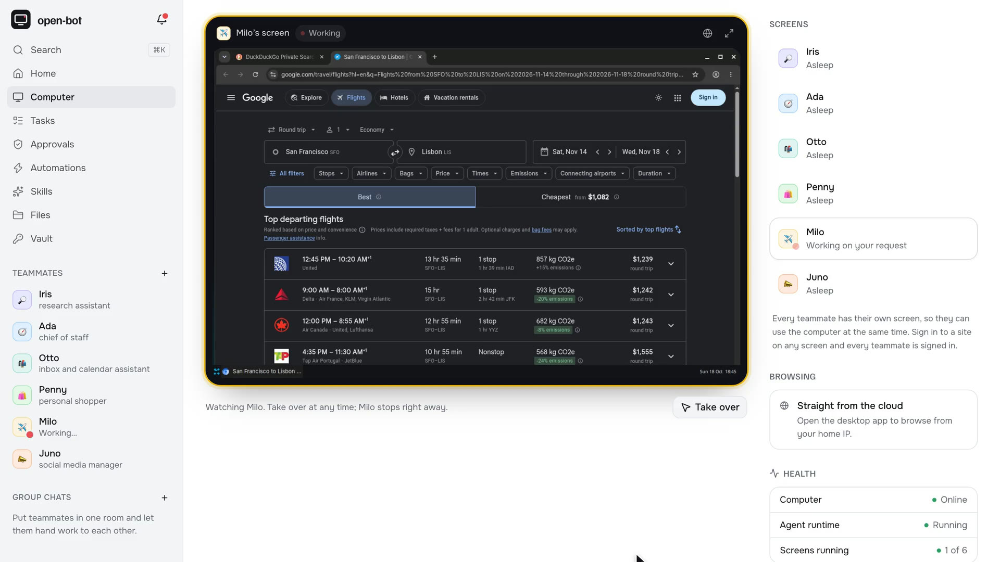

# Vishnuvardhan Reddy

**Software engineer building AI products & data-intensive systems.**

`Hyderabad, India` &nbsp;·&nbsp; `SWE III @ FactSet` &nbsp;·&nbsp; [`vvr.dev`](https://vvr.dev)

---

I build and ship products end-to-end - three live right now, the older two with real users.
**[open-bot](https://useopenbot.com)** gives AI teammates a computer of their own, and you can watch them work and take the wheel any time.
**[Chat with PDF](https://chatwithpdf.pro)** makes any document answerable, even the scanned ones.
**[VoiceFlow](https://voice-flow-max.vercel.app)** turns speech into polished writing in any app.
The day job at FactSet runs the same loop on data-intensive systems financial professionals rely on - intern to SWE III in three years, each rung earned, not gifted.
Either way, I build the version of a system I can still defend a year later - when the constraints have changed and the shortcut looks tempting.

### ⟢ Currently

- 🔧 &nbsp;Building **[open-bot](https://useopenbot.com)** - AI teammates with a computer of their own
- 📖 &nbsp;Re-reading *Designing Data-Intensive Applications*
- 🟢 &nbsp;LeetCode **Guardian** (top 1%) - 365-day streak and counting

### ⟢ Selected work

**[open-bot](https://useopenbot.com)** - AI teammates that do real work on a computer of their own, personal and open source.
> `Next.js` · `Codex app-server` · `Postgres` · `Docker` · `Electron`\
> live screen takeover · nothing ships without your OK · web, desktop & Android\
> &nbsp;[live ↗](https://useopenbot.com) &nbsp;·&nbsp; [repo ↗](https://github.com/VishnuVVR-369/open-bot)

**[Chat with PDF](https://chatwithpdf.pro)** - ask any document a question, even the scanned ones nobody can search.
> `Next.js` · `Convex` · `Google Document AI` · `Gemini Embeddings`\
> 150+ docs indexed · 100+ users · sub-3s answers\
> &nbsp;[live ↗](https://chatwithpdf.pro) &nbsp;·&nbsp; [repo ↗](https://github.com/VishnuVVR-369/chat-pdf)

**[VoiceFlow](https://voice-flow-max.vercel.app)** - system-level voice-to-text that turns speech into polished writing in any app.
> `Electron` · `Rust` · `Whisper` · `TypeScript`\
> 3–4× faster than typing · sub-1s latency · macOS / Windows / Linux\
> &nbsp;[live ↗](https://voice-flow-max.vercel.app) &nbsp;·&nbsp; [repo ↗](https://github.com/VishnuVVR-369/voice-flow)

**[SceneVault](https://excalidraw-service.vercel.app)** - an Excalidraw library service: organize unlimited scenes in nested folders, generate diagrams from a prompt, and edit them live with others.
> `Next.js` · `Convex` · `Better Auth` · `Cloudflare R2`\
> AI diagram generation · real-time collab rooms · folder search & autosave\
> &nbsp;[live ↗](https://excalidraw-service.vercel.app) &nbsp;·&nbsp; [repo ↗](https://github.com/VishnuVVR-369/scene-vault)

Full case studies, decisions, and tradeoffs → **[vvr.dev/projects](https://vvr.dev/projects)**

### ⟢ Stack

### ⟢ By the numbers

  

  

---

I read every email - the short ones get the fastest replies. More at **[vvr.dev](https://vvr.dev)**.
